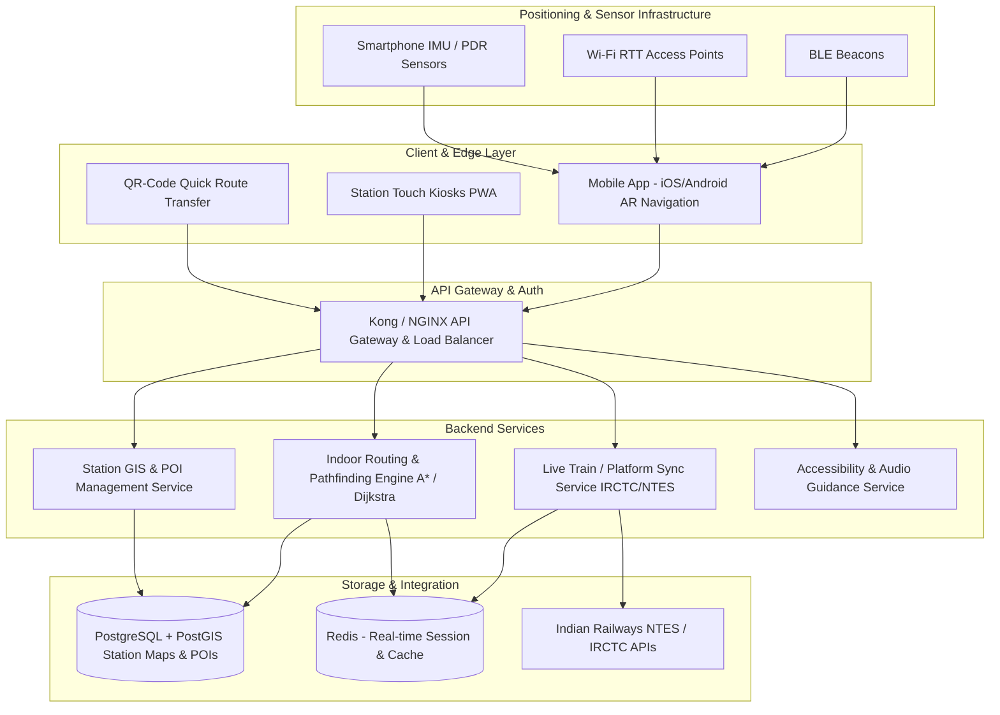

# Smart India Hackathon Workshop
# Date: 26-10-2026
## Register Number: 2122240400022
## Name: Anand K
## Problem Title
SIH 1710: Enhancing Navigation for Railway Station Facilities and Locations
## Problem Description
Background: Railway stations are complex environments with numerous facilities and locations such as ticket counters, platforms, restrooms, food courts, and waiting areas. Passengers often face difficulties in navigating these spaces, especially in large or unfamiliar stations. Efficient and user-friendly navigation systems are crucial for improving passenger experience, reducing congestion, and ensuring timely travel connections. Description: The problem involves developing a comprehensive navigation solution for railway stations that assists passengers in locating various facilities and destinations within the station premises. This includes creating detailed maps, providing real-time directions, and integrating features such as accessibility options for individuals with disabilities. The solution should be intuitive, easy to use, and accessible via multiple platforms, including mobile devices and digital kiosks. Key challenges include updating navigation information in real-time, ensuring accuracy, and accommodating the diverse needs of all passengers. Expected Solution: The expected solution is a multi-platform navigation system that provides detailed, real-time directions to all facilities and locations within a railway station. This system should include: A mobile application with 3D interactive maps and step-by-step navigation. Digital kiosks located throughout the station with touch-screen interfaces. Voice-guided navigation for visually impaired passengers. Regular updates to reflect changes in station layout and facility locations. Integration with existing railway apps and services for seamless user experience. The solution should enhance the overall passenger experience by reducing confusion, saving time, and improving accessibility within the station.

## Problem Creater's Organization
Ministry of Railway

## Idea
Develop an intelligent indoor navigation and wayfinding platform specifically tailored for railway station complexes, combining **BLE (Bluetooth Low Energy) beacon / Wi-Fi RTT positioning**, **interactive 2D/3D indoor floor mapping**, and **Augmented Reality (AR) path projection**. The system enables seamless turn-by-turn routing across multi-level station platforms, concourses, overbridges, waiting lounges, and utility amenities. It includes accessibility-focused routing (ramps, elevators, wheelchair-accessible paths) and voice-directed navigation for visually impaired passengers, accessible through both a cross-platform mobile application and interactive touch-screen kiosks stationed across terminal entry points.

## Proposed Solution / Architecture Diagram

### Architecture Overview
The platform follows a layered, microservices-oriented architecture comprising:
1. **Presentation Layer**: 
   - Cross-platform Mobile App (Flutter/React Native) with AR-assisted camera navigation & multilingual audio cues.
   - Web-based Touch Kiosks (Progressive Web App) deployed at strategic terminal hubs with offline fallbacks and QR route hand-off to passenger phones.
2. **Indoor Positioning & Spatial Engine**:
   - Hybrid indoor localization fusing BLE Beacons, Wi-Fi RTT, and smartphone sensor Dead Reckoning (IMU/PDR).
   - Spatial graph engine calculating Dijkstra/A* multi-floor shortest and accessible paths.
3. **Application & Service Layer**:
   - Navigation & Routing Service: Real-time route optimization taking into account dynamic crowds, maintenance closures, and platform changes.
   - Station Layout & GIS Management API: Station master dashboard for live layout updates and amenity statuses.
   - Integration Gateway: Connects with IRCTC / NTES APIs for live train arrival/departure and dynamic platform assignment feeds.
4. **Data & Storage Layer**:
   - Spatial Database (PostgreSQL + PostGIS) storing vectorized station topologies, coordinates, and POIs.
   - Cache Layer (Redis) for real-time tracking of train-to-platform mappings and kiosk states.

### Architecture Diagram (Mermaid)

## Use Cases
1. **Platform Wayfinding during Platform Shift**:
   - Passenger arrives at the concourse; the app alerts them of a live platform update for their train and computes the fastest route across foot-overbridges (FOBs) or escalators.
2. **Accessible Path Planning for Specially-Abled (Divyangjan) & Elderly**:
   - Passenger selects "Wheelchair / Step-Free" route option; the system guides exclusively through ramps, tactile pavements, and designated lifts, bypassing staircases.
3. **Audio-Guided Navigation for Visually Impaired**:
   - Voice guidance provides spatial awareness with vibration haptics and descriptive landmark cues (e.g., "Ticket counter on your left in 10 meters").
4. **Amenity & Facility Locator**:
   - Quick lookup and routing to nearest facilities: restrooms, baby-care rooms, cloakrooms, wheelchair assistance booths, ATVMs, food courts, and emergency medical rooms.
5. **Kiosk to Mobile Route Transfer**:
   - Commuters without the app can browse directions on a station touchscreen kiosk, scan an on-screen QR code, and continue following the route directly in their phone browser without installing an app.

## Technology Stack
- **Frontend / Mobile App**: Flutter / React Native, Mapbox GL / OpenLayers, ARCore / ARKit (for AR wayfinding).
- **Kiosk Frontend**: React.js / Vue.js (Progressive Web Application), WebGL / Three.js for interactive 3D floor maps.
- **Backend Services**: Node.js (NestJS) or Python (FastAPI), Go (for high-throughput spatial pathfinding).
- **Indoor Localization**: BLE 5.0 Beacon Trilateration, Wi-Fi 802.11mc (RTT/FTM), Pedestrian Dead Reckoning (PDR).
- **Databases & Cache**: PostgreSQL with PostGIS extension (spatial data/geometry), Redis (in-memory route cache & queue).
- **DevOps & Cloud**: Docker, Kubernetes, NGINX / Kong Gateway, GitHub Actions CI/CD.

## Dependencies
- **Hardware Dependencies**:
  - BLE 5.0 Beacons (installed at 10–15m intervals across station concourses, platforms, and stairways).
  - High-density Wi-Fi Access Points supporting 802.11mc Fine Timing Measurement.
  - Interactive Digital Touchscreen Kiosks (Commercial Displays with capacitive touch).
- **Software & API Dependencies**:
  - OpenStreetMap (OSM) / QGIS for station floor plan vectorization and digitizing CAD station blueprints.
  - Indian Railways NTES (National Train Enquiry System) / CRIS APIs for live platform allotment feeds.
  - Text-to-Speech (TTS) engine (Google TTS / Web Speech API) supporting English, Hindi, and regional languages.
  - Google ARCore / Apple ARKit libraries for smartphone augmented reality tracking.
  - PostGIS spatial routing libraries (`pgRouting`).
